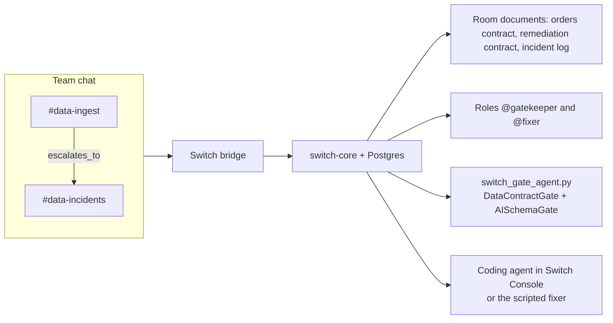

# switch-data-room

Data Reliability Room for Flip the Switch, Track 01 (best business workflow).

A partner CSV lands with schema drift. `@gatekeeper` checks it with DataContractGate, quarantines the bad rows, and escalates to `@fixer`. The coding agent's remediation JSON is checked with AISchemaGate before anyone is asked to approve it. The approval happens in the same chat.

Switch is the place the work runs. The contracts live in room documents, the two seats are room roles, and `#data-ingest` escalates to `#data-incidents` through a room link. Mattermost (bundled with a local Switch server), Slack, and Discord are surfaces on that same room. The workflow needs those Switch primitives. This process decides; Switch carries the conversation.

That is the whole product. Use of Switch is 30% of the hackathon score, and this room stops working if you take Switch away:

- The active contract is a **room document** (`load_internal_documents`), so the person, `@gatekeeper`, and `@fixer` read one copy.
- `@gatekeeper` and `@fixer` are **roles** (`assume_role`). The chat addresses the seat, so the coding agent can move machines and the room still says `@fixer`.
- `#data-ingest` **links** to `#data-incidents` with label `escalates_to`. Clean heartbeats stay in ingest. Broken drops move.
- The **collaboration bridge** is what puts that same room in Mattermost, and later in Slack or Discord. There is no second workflow for each chat app.

Agent protocol: <https://docs.switchagents.ai/switch-rooms/internals/agent-protocol.md>. Quickstart: <https://docs.switchagents.ai/switch-rooms/getting-started/index.md>.



## Rooms

| Room | Role | What it is for |
| --- | --- | --- |
| `#data-ingest` | `@gatekeeper` | A drop arrives. `check <file>` runs DataContractGate. A clean batch stays here. |
| `#data-incidents` | `@gatekeeper` and `@fixer` | Failure facts, the fixer proposal, the AISchemaGate result, human approval, and the recheck. |

`#data-ingest` links to `#data-incidents` with the label `escalates_to`. The link is in `switch-rooms.template.yaml`.

Room documents, stored in the room rather than only in this git tree:

- `orders_contract.yaml` — DataContractGate spec (quantity `1..500`, currency `USD`/`EUR`/`GBP`, `order_id` primary key)
- `remediation_output_contract.yaml` — AISchemaGate spec for the fixer JSON
- `incident_log.md` — updated after a clean recheck

`@gatekeeper` is the role held by `switch_gate_agent.py` (`data-gatekeeper` on a live server). `@fixer` is the role for the coding agent you connect in Switch Console, or for `data-fixer` when you run `make live-loop`. Switch rejects an alias that uses the same name as a role, so the template defines the roles and does not also alias the agents to those names. A targeted message to the role is how the room reaches whoever holds it.

The fixer role text in the template is the brief: one fenced JSON object, a diff, no weakening of a required field or the primary key unless `human_override_required` is true, and no apply until a person sends `@fixer approve patch`.

## Clone and run

Offline, no Switch server. CI runs the same tests.

```bash
git clone https://github.com/nightmoose/switch-data-room.git
cd switch-data-room
python3 -m pip install -r requirements.txt
make test
make demo
```

`make setup` is the install step. `make drop-dirty` writes `drops/orders_2026-11-05.csv`: 240 rows, 177 valid, 63 invalid (59 lowercase `usd`, 4 negative quantities). `make demo` plays the room on stdout:

1. `@gatekeeper check` fails the raw file and writes `quarantine/orders_2026-11-05/rejected.csv` plus `report.json`.
2. A scripted `@fixer` posts a schema-valid proposal that miscounts the failures and widens quantity to `1..1000`. AISchemaGate answers `BLOCKED`.
3. The repaired proposal keeps `1..500`, uppercases currency, and routes negative quantities to refunds. AISchemaGate answers `PASS`.
4. A person sends `@fixer approve patch`.
5. `@gatekeeper recheck` runs the normalizer and reports `240 / 240 rows valid (236 orders, 4 routed refunds, 0 quarantined)`.

`check` validates the file as it landed. `recheck` runs only after AISchemaGate has passed and the approval was recorded in this process. Paths named in chat have to stay inside the repo root.

Row checks use `contractgate` 0.4.1 (`Contract.from_yaml(...).compile().validate`). Remediation JSON uses `aischemagate` 0.5.0, the same local validator under the AISchemaGate name. Three grounding rules sit on top of that schema check: cited counts must appear in the DataContractGate facts, cited columns and files must exist, and a required field or primary key stays in force unless `human_override_required` is true. The offline path uses those local validators.

## Run it in Switch

Copy `.env.example` to `.env`. The agent reads `.env` without overriding variables you already exported. Do not commit `.env` or `.switch/`.

| Variable | Purpose |
| --- | --- |
| `SWITCH_BRIDGE_URL` | Agent bridge, usually `http://127.0.0.1:8000`. The Gateway UI is a different port. |
| `SWITCH_REGISTRATION_KEY` | Registration key, used once for `POST /agents`. A Gateway API key of type registration, or the deployment bootstrap token. |
| `SWITCH_AGENT_ID`, `SWITCH_AGENT_API_KEY` | Set after registration. The API key is returned once. |
| `SWITCH_AGENT_NAME` | Default `data-gatekeeper`. |
| `SWITCH_INGEST_ROOM`, `SWITCH_INCIDENTS_ROOM` | Room names. Ids are optional overrides. |

```bash
python3 switch_gate_agent.py register
python3 switch_gate_agent.py
```

Registration sends `connection_model: always_on` and `message_exchange: true`, then `GET /agents/{id}/ops` and calls the live operation names. The socket is `/agents/{id}/connection/ws` with a stable `connection_id`. The process answers server pings with `{"type":"pong","cursor":...}`, claims both rooms with `connect_to_room`, and assumes `@gatekeeper`. It loads `orders_contract.yaml` and `remediation_output_contract.yaml` with `load_internal_documents` when those room documents exist, and falls back to `contracts/` otherwise. A clean recheck calls `update_room_document` on `incident_log.md`, and `create_room_document` when the template copy belongs to someone else.

On startup it tries `update_agent_detail` with `addressing: anyone`, which is what the agent protocol docs describe. If the server refuses a self-update, set "who can address this agent" to anyone in Switch Console. Until that is set, a message from someone other than the owner gets a refusal instead of a check.

`make test` never opens this socket.

### Switch Console and bundled Mattermost

The fastest local server is Switch Console, which starts Switch and Mattermost for you. Install it from the [Console install page](https://docs.switchagents.ai/switch-rooms/getting-started/install-switch-console.md). Linux x86_64 and arm64 builds are published (AppImage, deb, rpm) and marked early access. On Wayland, especially inside a VM, the window can fail to draw; the [troubleshooting page](https://docs.switchagents.ai/switch-rooms/resources/troubleshooting.md) says to start it with `switch-console --ozone-platform=x11 --disable-gpu`.

In Console, run a server on this computer and start it (Docker has to be running). When the local server is up, create a registration key, fill in `.env`, and register the gatekeeper. Import `switch-rooms.template.yaml` from the Templates page. Choose the registered gatekeeper and the coding agent that should hold `@fixer`.

Mattermost comes up with that server. With the official Compose profiles it is on port `8065`. Open `#data-ingest` and send:

```text
@gatekeeper check drops/orders_2026-11-05.csv
```

### Docker Compose from the published stack

Switch publishes the Compose file as an OCI artifact, `ghcr.io/sandbox-quantum/standalone-compose:<version>`, and the images `ghcr.io/sandbox-quantum/switch-core`, `gateway`, and `setup` at that same version. Set `SWITCH_VERSION` to that tag. The Compose file requires it. Console release numbers and server release numbers are different lists. The self-host page is <https://docs.switchagents.ai/switch-rooms/deploy/self-host.md>.

`make switch-up` pins **0.31.0**, the newest non-rc tag on that registry as of 2026-11-05. `0.32.0-rc.1` is also published. Opt into it with `SWITCH_VERSION=0.32.0-rc.1 make switch-up`.

```bash
make switch-up
make switch-down
make live-loop
```

`make switch-up` runs `oras pull` and `docker compose --profile collab --profile gateway up`. It writes `.switch/standalone/.env` (mode 600) with generated passwords and `AGENT_REGISTRATION_TOKEN`. That directory is gitignored. The agent API is `http://127.0.0.1:8000`, the Gateway is `http://127.0.0.1:3000`, and Mattermost is `http://127.0.0.1:8065` (team `switch`, login `user`). The password is `MATTERMOST_USER_PASSWORD` in the generated env file.

On 2026-11-05 this stack came up on Switch 0.31.0 and the room loop ran. `make live-loop` registered `data-gatekeeper` and `data-fixer`, created `#data-ingest` and `#data-incidents` with the roles and contract documents, and posted the check, the blocked proposal, the passing proposal, `@fixer approve patch`, and the recheck. Mattermost has those posts. Redacted logs are in `demo_run/`. The shot list is [docs/DEMO_SCRIPT.md](docs/DEMO_SCRIPT.md).

The bootstrap agent could not run `create_room_from_yaml` because it has no linked Mattermost identity for `{$creator}`. The Gateway admin session validated the template (`ok: true`, no warnings) and saved it as "Data reliability room". Import that saved template from Switch Console once your account is linked to Mattermost, and pass the two agent names as the params.

### Connect the coding agent

In Switch Console, connect the coding agent you already run, set its directory to this repo, and select it as `fixer_agent` when you run the template. Console exposes the room operations (`read_context`, `load_internal_documents`, `post_message`, `send_targeted_message`, `update_room_document`) to that session. The `@fixer` instructions tell it how to answer. Until that session exists, `make demo` and `make live-loop` use the scripted fixer so the BLOCK then PASS loop is visible.

Discord and Slack use the same rooms after you connect those bridges in Console.

## Demo video script

Full shot list: [docs/DEMO_SCRIPT.md](docs/DEMO_SCRIPT.md). Under 2:30. Mattermost is enough.

| Time | On screen |
| --- | --- |
| 0:00–0:25 | `#data-ingest` linked to `#data-incidents`, roles `@gatekeeper` and `@fixer`, room documents |
| 0:25–1:00 | `@gatekeeper check drops/orders_2026-11-05.csv` → 63 rows quarantined, escalate to `@fixer` |
| 1:00–1:45 | Ungrounded proposal (`1..1000`) → `[AISchemaGate: BLOCKED]`, then the repaired proposal → `PASS` |
| 1:45–2:15 | `@fixer approve patch`, then recheck → `240 / 240 rows valid (236 orders, 4 routed refunds, 0 quarantined)` |
| 2:15–2:30 | `make demo` in this README, and the room documents, roles, and link that carry the loop to any chat app |

## Troubleshooting

### Containers cannot reach Postgres

`make switch-up` on Docker 29 with both iptables-nft and iptables-legacy can leave the bridge dropping inter-container traffic. ARP succeeds and `nc postgres 5432` from `init-db` times out, so init-db exits after 30 tries. Host `127.0.0.1:5432` still answers. `scripts/pull-switch-compose.sh` inserts a hairpin ACCEPT on `DOCKER-FORWARD` for each `br-*` interface, on both `iptables` and `iptables-legacy`, when that rule is missing. The repair uses `sudo`. A Docker host that already has the rule is left as it is.

### The agent cannot set its own addressing

`update_agent_detail` with `addressing: anyone` returns 403 on Switch 0.31.0. The detail says an agent cannot change its own settings. The protocol page describes that call. The server reserves it for the owner. As Gateway admin, `PUT /gateway/agents/{id}/addressing-policy` with `{"policy": null}` opens the agent to anyone. The live loop did that. Two agents owned by Agent Bootstrap could already address each other before that change. A Mattermost teammate needs the open policy.

### Template import from an unlinked agent

`create_room_from_yaml` from the bootstrap agent returns 400 because `{$creator}` has no linked Mattermost account. `POST /gateway/templates/validate` on the admin session returned `ok: true` with an empty warning list, and the document was saved. Run the template from Console as a person whose Mattermost identity is linked. The live loop created the same rooms, roles, documents, and `escalates_to` link with `create_room` when the YAML run was refused.

### Alias matches a role

Switch 0.31.0 rejects an alias named `gatekeeper` when a role is also named `gatekeeper`. The template keeps the role and leaves the alias out. Address `@gatekeeper` as the role.

## Layout

```text
switch_gate_agent.py              Switch agent protocol client and process entry
switch-rooms.template.yaml        #data-ingest, #data-incidents, roles, documents, escalates_to
scripts/pull-switch-compose.sh    pin Switch 0.31.0 and start Mattermost
scripts/live_room_loop.py         one live check, BLOCK, PASS, approve, recheck
docs/DEMO_SCRIPT.md               shot list for the recording
demo_run/                         redacted log of the 2026-11-05 live loop
contracts/                        orders and remediation contracts
data_room/                        validation, grounding, normalizer, offline demo
drops/                            generated CSV (gitignored)
quarantine/<stem>/                rejected.csv, report.json, refunds.csv on recheck
accepted/                         order rows after a passing recheck (gitignored)
```

## License

MIT. See `LICENSE`. `contractgate` and `aischemagate` are installed from PyPI and are not vendored.
